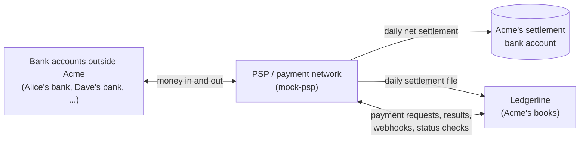
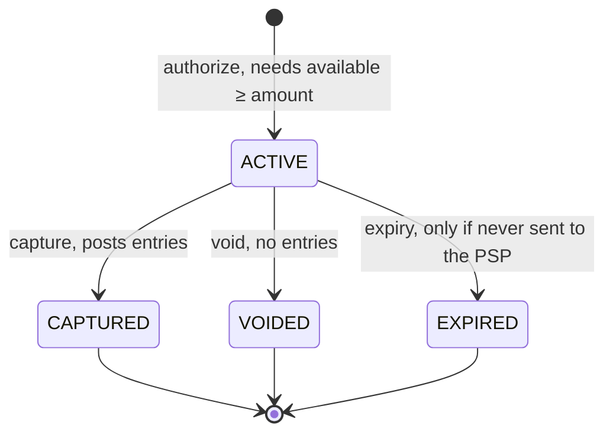
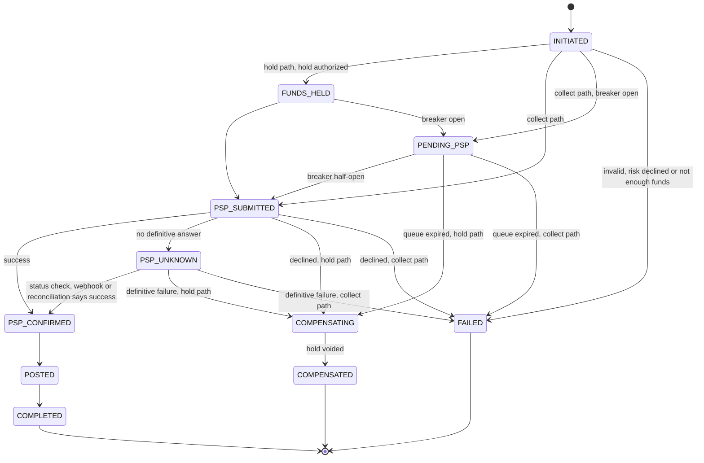

# Ledgerline domain model

> **Status:** Stage 0 (`v0.0`). This document is the source of truth for the
> money model. If code, schema or tests disagree with it, one of them is wrong.
> Fix it deliberately, and write an ADR if a decision changes.
>
> **All money is simulated.** The PSP, the banks and the people are fictional.
> Nothing here is real UPI/NPCI.
>
> **The examples are machine-checked.**
> `java tools/domain-check/DomainCheck.java DOMAIN.md` replays every posting
> and hold in [§11](#11-worked-examples). It fails if a transaction doesn't
> balance or a stated balance doesn't match its entries.

## Contents

1. [What Ledgerline is](#1-what-ledgerline-is)
2. [Double-entry in five minutes](#2-double-entry-in-five-minutes)
3. [Money](#3-money)
4. [Accounts](#4-accounts)
5. [Transactions and entries](#5-transactions-and-entries)
6. [Balances and holds](#6-balances-and-holds)
7. [Payments and the saga](#7-payments-and-the-saga)
8. [Settlement and reconciliation](#8-settlement-and-reconciliation)
9. [Invariants](#9-invariants)
10. [Business policies (defaults)](#10-business-policies-defaults)
11. [Worked examples](#11-worked-examples)
12. [Glossary](#12-glossary)
13. [Open questions](#13-open-questions)

## 1. What Ledgerline is

Ledgerline keeps the books for **tenants**. A tenant is a business that runs a
wallet and merchant-payments programme on Ledgerline. The running example is a
tenant called **Acme**.

- Acme's **customers** hold **wallets**: stored value that Acme owes them.
- Acme's **merchants** hold **merchant accounts**: sales proceeds, net of fees,
  that Acme owes them until they are paid out.
- A **PSP** (payment service provider, simulated by `mock-psp`) acts as the
  payment network. It authorises and records every payment, and it moves money
  between Acme and bank accounts outside Acme. Once a day it settles the net
  amount into Acme's **settlement bank account** and sends a **settlement
  file** that lists every transaction.



Ledgerline never touches real money. It keeps the books, and the PSP moves the
cash. Three rules shape everything that follows:

1. **Ledgerline is the system of record for balances. The PSP is the system of
   record for whether money moved.** Ledgerline never assumes a PSP outcome it
   hasn't been told.
2. **Every payment a customer or merchant starts goes through the PSP**, even
   when both sides are Acme accounts ("on-us"). Ledgerline posts on its own
   only for the fee leg inside a payment, settlement, reconciliation
   adjustments and reversals
   ([ADR-0005](docs/adr/0005-payment-flow-model.md)). This is a rule of our
   simulated network. Real wallets often settle on-us transfers internally.
3. **Nothing crosses a tenant boundary.** Every account, transaction, hold and
   payment belongs to exactly one tenant. All the examples here are inside
   Acme, in INR.

## 2. Double-entry in five minutes

The core idea: **money is never created or destroyed inside the books. It moves
from one account to another**, and the ledger records both sides of every move.

- A **transaction** is a group of **entries** written atomically. Each entry
  **debits** or **credits** one account with a positive amount.
- In every transaction, for each currency, **total debits = total credits**.
- *Debit* and *credit* do not mean minus and plus. Each category of account has
  a **normal side**, the side that increases it:

| Category | What it is for Acme | Normal side | A debit | A credit | Ledgerline accounts |
|---|---|---|---|---|---|
| Asset | what Acme has or is owed | debit | increases it | decreases it | settlement bank, PSP clearing |
| Liability | what Acme owes others | credit | decreases it | increases it | wallets, merchant accounts, suspense |
| Revenue | what Acme has earned | credit | decreases it | increases it | fee revenue |
| Expense | what Acme has lost or spent | debit | increases it | decreases it | write-off |

(Accounting also has *equity*, Acme's own capital. Acme's books don't need it
yet.)

A one-line example: the PSP confirms it collected ₹100.00 for Alice's wallet.

| Account | Debit | Credit | Why |
|---|---:|---:|---|
| PSP clearing (asset) | 10000 | | the PSP now owes Acme ₹100.00 |
| Alice's wallet (liability) | | 10000 | Acme now owes Alice ₹100.00 |

**Why all balances sum to zero.** Count each debit as +amount and each credit
as −amount. Every transaction sums to zero, so the sum across all accounts is
zero too. Read through normal sides, this is the accounting equation:
**Assets + Expenses = Liabilities + Revenue** (+ Equity). Stage 2's property
tests and the verifier job check exactly this.

## 3. Money

The full reasoning is in [ADR-0002](docs/adr/0002-money-as-integer-minor-units.md).

| Rule | Detail |
|---|---|
| Representation | `Money = (amount, currency)`. `amount` is a `long` count of **minor units**, and `currency` is an ISO 4217 code. ₹1,000.00 is `{"amount": 100000, "currency": "INR"}`. |
| Decimals vary | INR and USD have 2 (paise, cents), JPY 0, KWD 3, CLF 4. Take the count from ISO 4217 data. Never assume 2. |
| No floating point | No `float`/`double` in Java. Postgres uses `bigint`, never `real` or fractional `numeric`. JSON uses integers. |
| One currency at a time | Adding INR to USD throws, because it's a bug, not a conversion. Every account has exactly one currency. FX is a non-goal. |
| Overflow fails | Arithmetic uses overflow-checked operations (`Math.addExact`). A wrapped number is an error. |
| API limits | Each request amount must be between 1 and 10^12 minor units. That is far below 2^53, so the TypeScript dashboard reads every amount exactly. |
| Fees | Rates are integer **basis points** (1 bp = 0.01%). `fee = round_half_up(amount × bps / 10 000)`, computed once. The counterparty gets `amount − fee`, so `fee + net = amount` exactly. Rounding never creates or loses a paisa. |

**Rounding example.** Chai Co's fee is 200 bp (2.00%). On ₹999.99 = 99999
paise, 99999 × 200 / 10000 = 1999.98. That rounds to a **2000** paise fee, and
Chai Co receives 99999 − 2000 = **97999** paise. Example E3 posts exactly this.

## 4. Accounts

An **account** holds value in **one currency** inside **one tenant's** books.
Its fields are `id` (UUIDv7), `tenant_id`, `type`, `currency` and `holder_ref`
(the opaque id of the customer or merchant; empty for system accounts). Its
category, normal side and non-negative flag come from its type. The full
reasoning is in
[ADR-0003](docs/adr/0003-chart-of-accounts-and-sign-convention.md).

### 4.1 Account types

| Type | Category | Normal side | Non-negative | Holder | Purpose |
|---|---|---|---|---|---|
| CUSTOMER_WALLET | LIABILITY | CREDIT | yes | customer | Stored value Acme owes a customer. Never below zero. |
| MERCHANT | LIABILITY | CREDIT | no | merchant | Sales proceeds, net of fees, that Acme owes a merchant until payout. Negative means the merchant owes Acme. Only a forced debit (a chargeback or an adjustment) can cause that. |
| PSP_CLEARING | ASSET | DEBIT | no | system | Money in flight with the PSP. Positive: the PSP owes Acme. Negative: Acme owes the PSP, or received cash it can't explain yet. Zero once a settlement day is reconciled. |
| SETTLEMENT_BANK | ASSET | DEBIT | no | system | Mirror of Acme's real bank account that the PSP settles into. It moves only when cash really moves. |
| FEE_REVENUE | REVENUE | CREDIT | no | system | Fees Acme has earned. |
| SUSPENSE | LIABILITY | CREDIT | no | system | Amounts reconciliation can't explain yet. Each amount has an open reconciliation break, and the target balance is zero. |
| WRITE_OFF | EXPENSE | DEBIT | no | system | Losses Acme decides to absorb, e.g. a suspense item that can't be recovered. |

When a tenant is onboarded, it gets one of each system account per currency.
The brief's system accounts map onto these types: suspense is SUSPENSE, fees is
FEE_REVENUE, settlement is SETTLEMENT_BANK, and PSP-clearing is PSP_CLEARING.

### 4.2 The non-negative flag

- **It is absolute.** A non-negative account's *available* balance (§6) never
  goes below zero, not for a forced debit and not under concurrency. A posting
  or hold that would break this is rejected.
- **Wallets are non-negative**, because stored value can't be overdrawn.
- **Merchant accounts are not.** The payer's bank forces a chargeback on Acme,
  and it must be recorded even when the merchant has nothing left. The
  merchant then owes Acme, and can't refund or be paid out until new sales
  cover the deficit (E5).
- **System accounts are not**, because they record facts (cash in the bank,
  money the PSP owes), and the ledger must always be able to record a fact.

### 4.3 No personal data

Ledger tables hold opaque references only (`holder_ref = cus_01J…`). They never
hold names, phone numbers, VPAs or bank details. This document says "Alice"
only for readability.

## 5. Transactions and entries

A **transaction** is an atomic, balanced set of entries. Its fields are `id`
(UUIDv7), `tenant_id`, `type` (`PAYMENT`, `TOP_UP`, `CHARGEBACK`, `SETTLEMENT`,
`ADJUSTMENT`, `REVERSAL`, ...), `reference` (the payment or reconciliation
break that caused it), an optional `reverses`, and `recorded_at` (UTC). An
**entry** is one line: `account`, `direction` (DEBIT or CREDIT), `amount`
(> 0, in minor units) and `currency`.

Rules:

1. A transaction has at least two entries.
2. For each currency, total debits = total credits.
3. Each entry's currency equals its account's currency.
4. Every account belongs to the transaction's tenant.
5. Transactions and entries are never updated or deleted. To fix a mistake,
   post a **reversal**: a new transaction with the same entries, debits and
   credits swapped, pointing at the original through `reverses`. A transaction
   can be reversed at most once. Then, if needed, post the correct
   transaction. Partial corrections are explicit `ADJUSTMENT` transactions.

**Computing balances.** Let *signed(entry)* be +amount for a debit and −amount
for a credit.

- **Raw balance** = Σ signed(entries). It is debit-positive, and across all
  accounts of a tenant and currency it always sums to 0.
- **Ledger balance** = the raw balance for debit-normal accounts, and −(raw
  balance) for credit-normal accounts. This is the number people read: a
  wallet with a ledger balance of 100000 means Acme owes Alice ₹1,000.00.

## 6. Balances and holds

Each account has three balances, all in its normal direction:

| Balance | Definition | Changes when |
|---|---|---|
| Ledger | Σ posted entries (§5) | a transaction is posted |
| Held | Σ amounts of the account's ACTIVE holds | a hold is authorized, captured, voided or expires |
| Available | ledger − held | either of the above changes |

A **hold** reserves part of an account's available balance for a payment that
hasn't finished, much like a card authorisation. It moves no money and creates
**no entries** ([ADR-0004](docs/adr/0004-holds-as-reservations.md)), so a hold
can never unbalance the books.



Rules:

1. **Authorize** needs `available ≥ amount`, on every account type. That is how
   a payment proves the money is there.
2. **Capture** posts a transaction that debits the held account by at most the
   held amount, and marks the hold CAPTURED, in the **same database
   transaction**. A partial capture releases the rest.
3. Each hold is resolved (captured, voided or expired) exactly once.
4. **Expiry** applies only to holds whose payment was never sent to the PSP,
   for example one queued in `PENDING_PSP` too long. A hold behind a payment
   the PSP may have executed (`PSP_SUBMITTED`, `PSP_UNKNOWN`) never expires.
   Expiring it would be a blind compensation (§7.3).
5. **Holder-initiated debits** (payments, refunds, payouts) need available
   funds, proven by a hold. **Forced debits** (chargebacks, reconciliation
   adjustments) skip that check, but a non-negative account still can't go
   below zero.

Example: Alice's ledger balance is 100000. A hold of 25000 leaves her with
**ledger 100000, held 25000, available 75000**. Nothing has moved, but she can
spend only ₹750.00 more.

## 7. Payments and the saga

A **payment** is a money movement that a customer or merchant asks for through
the public API. The payment-service drives each one with a **persisted saga**:
a state machine that stores every transition with its time and cause.

### 7.1 Payment types and saga paths

| Payment | From → to | What the PSP does | Saga path |
|---|---|---|---|
| Top-up | customer's outside bank → wallet | collects the money (pay-in) | collect |
| P2P | wallet → wallet | authorises it (on-us) | hold |
| Merchant payment from a wallet | wallet → merchant | authorises it (on-us) | hold |
| Merchant payment from outside | payer's outside bank → merchant | collects the money (pay-in) | collect |
| Refund | merchant → original payer | authorises it, or pays out if the payer is outside | hold |
| Payout | wallet or merchant → outside bank | pays out | hold |

- **Hold path** (the payer is an Acme account):
  `INITIATED → FUNDS_HELD → PSP_SUBMITTED → PSP_CONFIRMED → POSTED → COMPLETED`.
- **Collect path** (the payer is outside Acme):
  `INITIATED → PSP_SUBMITTED → PSP_CONFIRMED → POSTED → COMPLETED`. It skips
  `FUNDS_HELD`, because nothing in Acme's books can be reserved.

A **chargeback** isn't a payment. The PSP reports, through a signed webhook,
that a payer's bank reversed a payment funded from outside, and Acme records a
forced debit of the merchant (E5).

### 7.2 States

| State | Meaning | Books so far |
|---|---|---|
| INITIATED | accepted, validated, risk check passed | nothing |
| FUNDS_HELD | payer's funds reserved | hold ACTIVE |
| PENDING_PSP | queued because the PSP circuit breaker is open; submitted when it half-opens | hold (hold path) |
| PSP_SUBMITTED | request sent to the PSP | hold |
| PSP_UNKNOWN | the PSP may have executed the payment, but there is no definitive answer | hold, untouched |
| PSP_CONFIRMED | the PSP says it executed the payment | hold |
| POSTED | ledger transaction written: hold captured, or pay-in posted | entries |
| COMPLETED | result stored and `payment.completed` written to the outbox | entries |
| COMPENSATING | the PSP gave a definitive no; the hold is being released | hold being voided |
| COMPENSATED | terminal: the payment didn't happen and its hold was released | nothing |
| FAILED | terminal: the payment didn't happen and nothing needed undoing | nothing |



**How this reads the brief.** The brief lists "COMPENSATING → COMPENSATED /
FAILED". Here, COMPENSATED means "undone after funds were held", and FAILED
means "nothing to undo" (rejected before a hold, or a pay-in the PSP declined).
Voiding a hold is local and idempotent, so compensation retries until it is
done. If it hits an invariant violation (for example, the hold was already
captured), the saga stays in COMPENSATING and raises an alert for a person. It
never guesses.

### 7.3 Rules

1. **Every step is idempotent.** The hold, the capture and the PSP request are
   each keyed by the payment id. A retry finds the earlier result instead of
   doing the work twice.
2. **PSP idempotency.** Every PSP request carries the payment id as the
   PSP-side idempotency key. Status checks use the same key.
3. **A timeout is not a failure.** If the request may have reached the PSP and
   there is no definitive answer, the payment moves to PSP_UNKNOWN. The saga
   polls the PSP's status endpoint with exponential backoff and jitter. Signed
   webhooks and reconciliation can also resolve it. After the polling budget
   (default 30 minutes), the payment is escalated to reconciliation. It stays
   PSP_UNKNOWN and keeps its hold
   ([ADR-0006](docs/adr/0006-psp-timeouts-are-unknown-outcomes.md)).
4. **Never compensate blindly.** A hold is voided only after a definitive
   answer: an explicit PSP decline, a PSP "not found" after its dedupe window,
   or reconciliation proof that the PSP never executed the payment.
5. **Transitions only move forward.** Duplicate and out-of-order webhooks are
   no-ops once their transition has happened. A PSP outcome that contradicts a
   recorded one (FAILED after SUCCESS) is never applied automatically. It opens
   an incident.
6. **Breaker open: queue, don't fail.** While the PSP circuit breaker is open,
   new payments wait in PENDING_PSP (holding funds on the hold path), and the
   API returns `202 Accepted` with `status: PENDING_PSP`. They are submitted
   when the breaker half-opens.

## 8. Settlement and reconciliation

### 8.1 Settlement

- A **settlement day** is a UTC calendar day.
- By 06:00 UTC the next day, the PSP sends a settlement file for the day and
  moves the **net** amount to or from Acme's bank account.
- Each line has this net effect on what the PSP owes Acme:

| Line type | Examples | Net effect |
|---|---|---|
| PAY_IN | top-up, merchant payment from outside | + amount |
| PAY_OUT | payout, refund to an outside payer | − amount |
| ON_US | P2P, merchant payment from a wallet, refund to a wallet | 0 |
| CHARGEBACK | a payer's bank reversed a payment | − amount |
| DISPUTE_FEE | the PSP's fee per chargeback | − amount |

- Net settlement = Σ net effects. Ledgerline posts it as a debit to
  SETTLEMENT_BANK and a credit to PSP_CLEARING (the other way round when the
  net is negative).
- File columns (a draft; Stages 5 and 6 finalise them):
  `settlement_date, psp_ref, ledgerline_ref, type, payee, amount, currency, status`.

### 8.2 Reconciliation

The reconciliation job (Stage 6) matches each settlement-file line to
Ledgerline's records by `ledgerline_ref` (our payment id) or `psp_ref`, then
compares amount, currency and day. Every difference becomes a **break** with a
reason code:

| Reason code | Meaning | What the books do |
|---|---|---|
| AMOUNT_MISMATCH | matched, but the amounts differ | park the difference in SUSPENSE |
| CURRENCY_MISMATCH | matched, but the currencies differ | park each side in SUSPENSE in its own currency (amounts in different currencies can't be netted) |
| MISSING_IN_PSP | in the books, not in the file, and timing doesn't explain it | park the expected clearing amount in SUSPENSE |
| MISSING_IN_LEDGER | in the file, not in the books | park the line's net effect in SUSPENSE |
| TIMING_DIFF | the same item lands on adjacent settlement days | nothing to post. It resolves when the other side arrives (default window: 2 days); otherwise it becomes MISSING_IN_PSP or MISSING_IN_LEDGER |
| DUPLICATE_IN_PSP | the file lists the same item twice | park the extra line's net effect in SUSPENSE and claim it back from the PSP |

- No cash moves on ON_US lines, so their breaks open with nothing parked. Ops
  correct the books with an adjustment.
- A line that matches a payment still in PSP_UNKNOWN isn't a break. It's the
  answer that payment was waiting for (E7.2).
- **Resolving a break.** Ops move the amount out of SUSPENSE with an
  `ADJUSTMENT` transaction, either to the account it belongs to or to
  WRITE_OFF. Each resolution records who, when and why (the audit trail).

## 9. Invariants

I1–I11 restate the brief. I12–I18 follow from this document. "Proven in" names
the stage whose automated tests demonstrate the invariant.

| # | Invariant | Precisely | Enforced by | Proven in |
|---|---|---|---|---|
| I1 | Integer money | `long` minor units + ISO 4217 code; no floating point; no cross-currency arithmetic; overflow fails | `Money` type; ArchUnit bans `float`/`double` in domain code; `bigint` columns | 2 |
| I2 | Balanced transactions | ≥ 2 entries; per currency Σ debits = Σ credits; entry currency = account currency; amounts > 0 | the domain model **and** a deferred constraint trigger checked at commit | 2 |
| I3 | Immutable entries | no UPDATE or DELETE on entries or transactions; corrections are reversals, at most one per transaction | the app DB role lacks those privileges, plus a trigger | 2 (roles hardened in 7) |
| I4 | Balance = Σ entries | the stored balance is a projection, updated in the same DB transaction as the entries; a verifier job recomputes it continuously | posting code + verifier job (metric and alert) | 2 (alerting in 8) |
| I5 | No overdraft | non-negative accounts keep available ≥ 0, even under concurrency | the locking strategy (Stage 2 ADR) | 2, 3 |
| I6 | Idempotency | same key + same payload → same response, one effect; same key + different payload → 422; concurrent duplicates → one runs, the others wait or get 409 | idempotency table | 3 |
| I7 | Postgres decides idempotency | Redis, if used, is only a cache | design + tests that flush Redis | 3 |
| I8 | Outbox and idempotent consumers | events leave through the transactional outbox; delivery is at-least-once; consumers dedupe with an inbox table; never claim exactly-once | outbox relay + inbox table | 4 |
| I9 | Tenant isolation | `tenant_id` on every table; Postgres row-level security; all accounts in a transaction share one tenant | RLS policies + composite keys that include `tenant_id` | 7 |
| I10 | IDs and time | UUIDv7 ids from a library; UTC `Instant`; time comes from an injected `Clock` | shared lib + an ArchUnit rule against `Instant.now()` | 1, 2 |
| I11 | No PII in the ledger | opaque references only | schema review + ArchUnit and naming rules | 2 |
| I12 | Zero sum | per tenant and currency, raw balances sum to 0 | follows from I2; the verifier checks it | 2 (jqwik) |
| I13 | Hold integrity | amount > 0; authorize only if available ≥ amount; capture ≤ held amount; resolved exactly once | ledger hold API + DB constraints | 3 |
| I14 | Saga integrity | only the transitions in §7.2; each one persisted; terminal states are final; conflicting PSP outcomes open an incident | state machine + transition table | 5 |
| I15 | No blind compensation | holds of submitted or unknown payments are voided only on a definitive negative, and never expire | saga rules | 5 |
| I16 | Refund cap | Σ refunds of a payment, in-flight ones included, ≤ the original amount | payment-service, locking the payment row | 5 |
| I17 | Exact fee split | fee + net = gross; the fee is computed once | fee calculator + property tests | 2, 5 |
| I18 | Clearing returns to zero | once a settlement day is reconciled, PSP clearing holds nothing from that day; anything unexplained sits in SUSPENSE with an open break | reconciliation job | 6 |

## 10. Business policies (defaults)

| Policy | Default |
|---|---|
| Merchant fee | 200 bp (2.00%) of each merchant payment, rounded half-up once, deducted from the merchant's credit |
| P2P and top-up fees | none |
| Refunds | partial or full, any number of them while Σ refunds ≤ the original amount; the money goes back to the original source; funded from the merchant's available balance through a hold |
| Fees on refunds and chargebacks | not returned to the merchant |
| Chargebacks | the merchant is debited the full amount, even if its balance goes negative |
| Dispute fee | ₹150.00 (15000 paise) per chargeback, passed through to the merchant |
| Negative merchant balance | blocks refunds and payouts until new sales cover it |
| Hold expiry | 7 days, only for holds never sent to the PSP |
| PENDING_PSP queue | a queued payment expires after 24 hours and its hold is voided (safe, because the PSP never saw it) |
| Unknown-outcome polling | exponential backoff with jitter for 30 minutes, then escalation to reconciliation |

These are starting values, not measurements. Later stages may tune them.

## 11. Worked examples

One story runs through all seven examples, so each balance follows from the
ones before it.

- **Alice** and **Bob** are Acme customers with wallets.
- **Chai Co** is an Acme merchant with a 200 bp fee.
- **Dave** and **Erin** bank elsewhere, outside Acme's books.
- Amounts are in paise (₹1 = 100 paise). Day 1 is 2026-11-02 (UTC), and Day 2
  is 2026-11-03.

**How to read the tables.** Each step has an id such as **E2.1**, followed by
its saga state. For bookings outside a payment saga, such as chargebacks,
settlement and adjustments, the transaction type appears instead.

- Posting tables (`Account | Currency | Debit | Credit`) are ledger
  transactions.
- Hold tables (`Hold | Account | Action | Amount`) authorize, void or expire a
  hold. A capture is a posting whose caption says "captures H*n*".
- Balance tables (`Account | Ledger | Held | Available`) give the balances after
  the step; "—" means not shown.
- **Variants** start from an earlier step to show another outcome. They don't
  affect the story after them.

`DomainCheck` replays every step in order, checks each rule from §3–§6, and
compares every balance table with the replay.

Accounts used:

| Account | Type | Currency |
|---|---|---|
| settlement_bank | SETTLEMENT_BANK | INR |
| psp_clearing | PSP_CLEARING | INR |
| fee_revenue | FEE_REVENUE | INR |
| suspense | SUSPENSE | INR |
| wallet:alice | CUSTOMER_WALLET | INR |
| wallet:bob | CUSTOMER_WALLET | INR |
| merchant:chai | MERCHANT | INR |

### E1 — Wallet top-up

**Story.** Alice adds ₹1,000.00 to her wallet from her bank account outside
Acme (a pay-in). The money is outside Acme's books, so there is nothing to
hold, and the saga takes the collect path:
`INITIATED → PSP_SUBMITTED → PSP_CONFIRMED → POSTED → COMPLETED`.

**E1.1** `POSTED`: the PSP confirms it collected ₹1,000.00.

| Account | Currency | Debit | Credit |
|---|---|---:|---:|
| psp_clearing | INR | 100000 | |
| wallet:alice | INR | | 100000 |

Acme now owes Alice ₹1,000.00, so her wallet (a liability) is credited. The PSP
owes Acme the same ₹1,000.00 until it settles, so clearing (an asset) is
debited. Acme's bank balance doesn't change until settlement in E7.

| Account | Ledger | Held | Available |
|---|---:|---:|---:|
| psp_clearing | 100000 | — | — |
| wallet:alice | 100000 | 0 | 100000 |

### E2 — P2P transfer

**Story.** Alice sends Bob ₹250.00. Both wallets are in Acme's books, but the
PSP still authorises the payment (rule 2 in §1), so the saga reserves Alice's
money before asking. Path:
`INITIATED → FUNDS_HELD → PSP_SUBMITTED → PSP_CONFIRMED → POSTED → COMPLETED`.

**E2.1** `FUNDS_HELD`: reserve ₹250.00 of Alice's money.

| Hold | Account | Action | Amount |
|---|---|---|---:|
| H1 | wallet:alice | AUTHORIZE | 25000 |

| Account | Ledger | Held | Available |
|---|---:|---:|---:|
| wallet:alice | 100000 | 25000 | 75000 |

No money has moved, so Alice's ledger balance is unchanged. But she can spend
only ₹750.00 while the PSP works.

**E2.2** `POSTED`: the PSP confirms, and this posting captures H1.

| Account | Currency | Debit | Credit |
|---|---|---:|---:|
| wallet:alice | INR | 25000 | |
| wallet:bob | INR | | 25000 |

| Account | Ledger | Held | Available |
|---|---:|---:|---:|
| wallet:alice | 75000 | 0 | 75000 |
| wallet:bob | 25000 | 0 | 25000 |

Acme owes Alice ₹250.00 less and Bob ₹250.00 more. Its total obligations are
unchanged, and no cash moved.

**Variant: not enough money.** Bob tries to send ₹300.00 but has only ₹250.00.
The hold is rejected and the saga ends `INITIATED → FAILED`. Nothing needs
undoing.

<!-- branch E2-insufficient-funds from E2.2 -->

**E2.X1** Authorizing the hold fails.

| Hold | Account | Action | Amount | Result |
|---|---|---|---:|---|
| H9 | wallet:bob | AUTHORIZE | 30000 | rejected |

| Account | Ledger | Held | Available |
|---|---:|---:|---:|
| wallet:bob | 25000 | 0 | 25000 |

<!-- end branch -->

### E3 — Merchant payment with fee

**Story, part 1: paid from a wallet.** Alice pays Chai Co ₹400.00 from her
wallet. The fee is 200 bp of 40000 = 800 paise, so Chai Co gets 39200. This
uses the hold path.

**E3.1** `FUNDS_HELD`: reserve ₹400.00.

| Hold | Account | Action | Amount |
|---|---|---|---:|
| H2 | wallet:alice | AUTHORIZE | 40000 |

| Account | Ledger | Held | Available |
|---|---:|---:|---:|
| wallet:alice | 75000 | 40000 | 35000 |

**E3.2** `POSTED`: the PSP confirms, and this posting captures H2.

| Account | Currency | Debit | Credit |
|---|---|---:|---:|
| wallet:alice | INR | 40000 | |
| merchant:chai | INR | | 39200 |
| fee_revenue | INR | | 800 |

There is one debit and there are two credits. The transaction balances
(40000 = 39200 + 800) and splits the money between the merchant and Acme's
revenue.

| Account | Ledger | Held | Available |
|---|---:|---:|---:|
| wallet:alice | 35000 | 0 | 35000 |
| merchant:chai | 39200 | 0 | 39200 |
| fee_revenue | 800 | — | — |

**Story, part 2: paid from outside.** Dave, who banks elsewhere, pays Chai Co
₹999.99 by approving a collect request at his bank (a pay-in). The fee is
200 bp of 99999 = 1999.98, rounded half-up to 2000 (§3), so Chai Co gets 97999.
This uses the collect path, because nothing of Dave's is in Acme's books to
hold.

**E3.3** `POSTED`: the PSP confirms it collected ₹999.99 from Dave.

| Account | Currency | Debit | Credit |
|---|---|---:|---:|
| psp_clearing | INR | 99999 | |
| merchant:chai | INR | | 97999 |
| fee_revenue | INR | | 2000 |

| Account | Ledger | Held | Available |
|---|---:|---:|---:|
| psp_clearing | 199999 | — | — |
| merchant:chai | 137199 | 0 | 137199 |
| fee_revenue | 2800 | — | — |

### E4 — Refund

**Story.** Alice returns what she bought, and Chai Co refunds the full ₹400.00
of E3.2 to her wallet. A refund is funded from the merchant's available
balance, so the saga first holds Chai Co's money (hold path). Acme keeps the
800 paise fee (§10), so the refund costs Chai Co ₹400.00 even though it
received only ₹392.00 for the sale.

**E4.1** `FUNDS_HELD`: reserve ₹400.00 of Chai Co's balance.

| Hold | Account | Action | Amount |
|---|---|---|---:|
| H3 | merchant:chai | AUTHORIZE | 40000 |

| Account | Ledger | Held | Available |
|---|---:|---:|---:|
| merchant:chai | 137199 | 40000 | 97199 |

**E4.2** `POSTED`: the PSP confirms, and this posting captures H3.

| Account | Currency | Debit | Credit |
|---|---|---:|---:|
| merchant:chai | INR | 40000 | |
| wallet:alice | INR | | 40000 |

| Account | Ledger | Held | Available |
|---|---:|---:|---:|
| merchant:chai | 97199 | 0 | 97199 |
| wallet:alice | 75000 | 0 | 75000 |

The refund cap (I16) would reject a second refund of E3.2, because all 40000 of
it has already been refunded.

### E5 — Chargeback

**Story.** Dave tells his bank he never received what he bought, and his bank
charges back E3.3. The PSP sends a signed `chargeback` webhook and will deduct
₹999.99 plus a ₹150.00 dispute fee from Acme's next settlement. A chargeback is
forced on Acme: Chai Co is debited whether or not it has the money, with no
hold and no funds check. That is why merchant accounts aren't non-negative
(§4.2).

**E5.1** `CHARGEBACK`: take Dave's payment back out of Chai Co's balance.

| Account | Currency | Debit | Credit |
|---|---|---:|---:|
| merchant:chai | INR | 99999 | |
| psp_clearing | INR | | 99999 |

| Account | Ledger | Held | Available |
|---|---:|---:|---:|
| merchant:chai | -2800 | 0 | -2800 |
| psp_clearing | 100000 | — | — |

Chai Co is now 2800 paise short. That is exactly the two fees it paid
(800 + 2000) on two sales that have both been reversed.

**E5.2** `DISPUTE_FEE`: pass the PSP's ₹150.00 dispute fee on to Chai Co.

| Account | Currency | Debit | Credit |
|---|---|---:|---:|
| merchant:chai | INR | 15000 | |
| psp_clearing | INR | | 15000 |

| Account | Ledger | Held | Available |
|---|---:|---:|---:|
| merchant:chai | -17800 | 0 | -17800 |
| psp_clearing | 85000 | — | — |

Chai Co owes Acme ₹178.00. Its next sales pay that back first.

**Variant: a merchant with a negative balance can't refund.** Chai Co tries to
refund ₹50.00 to a customer. Its available balance is −17800, so the hold is
rejected and the refund fails (`INITIATED → FAILED`). Payouts are blocked the
same way.

<!-- branch E5-negative-merchant from E5.2 -->

**E5.X1** Authorizing the refund's hold fails.

| Hold | Account | Action | Amount | Result |
|---|---|---|---:|---|
| H8 | merchant:chai | AUTHORIZE | 5000 | rejected |

| Account | Ledger | Held | Available |
|---|---:|---:|---:|
| merchant:chai | -17800 | 0 | -17800 |

<!-- end branch -->

### E6 — PSP timeout: the outcome is unknown

**Story.** Alice pays Chai Co ₹300.00 from her wallet. The fee is 600, so Chai
Co gets 29400. The saga holds the money and calls the PSP, but the call times
out after the request was sent, so the PSP may or may not have executed the
payment.

**E6.1** `FUNDS_HELD`: reserve ₹300.00.

| Hold | Account | Action | Amount |
|---|---|---|---:|
| H4 | wallet:alice | AUTHORIZE | 30000 |

| Account | Ledger | Held | Available |
|---|---:|---:|---:|
| wallet:alice | 75000 | 30000 | 45000 |

What happens next on Day 1 (UTC). The time limits are starting defaults, and
Stage 5 will tune them.

| Time | Event | Saga state |
|---|---|---|
| 14:00:00.00 | request accepted, risk check passes | INITIATED |
| 14:00:00.04 | hold H4 authorized (E6.1) | FUNDS_HELD |
| 14:00:00.05 | request sent to the PSP with idempotency key = payment id | PSP_SUBMITTED |
| 14:00:03.05 | no answer within the 3-second limit; two retries with the same key also time out | PSP_SUBMITTED |
| 14:00:10 | retries used up, outcome unknown | PSP_UNKNOWN |
| 14:00 to 14:30 | status checks with backoff and jitter answer `PROCESSING` or time out | PSP_UNKNOWN |
| 14:30 | polling budget spent; escalated to reconciliation; H4 stays active and never expires | PSP_UNKNOWN |
| Day 2, 06:00 | Day 1's settlement file lists the payment as SUCCESS | resolved in E7.2 |

The books don't move during any of this. Alice sees ledger 75000, held 30000
and available 45000, shown to her as "₹300.00 pending".

**What must not happen.** At 14:00:03 it is tempting to call the payment failed
and void H4. If the PSP did execute it, Chai Co has been told it was paid, and
the void would let Alice spend the same ₹300.00 again. Acme would lose ₹300.00.
The saga voids a hold only on a definitive answer (§7.3).

**Variant A: a status check says SUCCESS.** The saga captures H4 at once, with
the same entries the main story posts later in E7.2:
`PSP_UNKNOWN → PSP_CONFIRMED → POSTED → COMPLETED`.

<!-- branch E6-status-success from E6.1 -->

**E6.A1** `POSTED`: a status check says SUCCESS, and this posting captures H4.

| Account | Currency | Debit | Credit |
|---|---|---:|---:|
| wallet:alice | INR | 30000 | |
| merchant:chai | INR | | 29400 |
| fee_revenue | INR | | 600 |

| Account | Ledger | Held | Available |
|---|---:|---:|---:|
| wallet:alice | 45000 | 0 | 45000 |
| merchant:chai | 11600 | 0 | 11600 |

<!-- end branch -->

**Variant B: a status check says FAILED.** That answer is definitive, so it is
safe to compensate: `PSP_UNKNOWN → COMPENSATING → COMPENSATED`.

<!-- branch E6-status-failed from E6.1 -->

**E6.B1** `COMPENSATING`: void H4.

| Hold | Account | Action | Amount |
|---|---|---|---:|
| H4 | wallet:alice | VOID | 30000 |

| Account | Ledger | Held | Available |
|---|---:|---:|---:|
| wallet:alice | 75000 | 0 | 75000 |

<!-- end branch -->

In the main story the outcome stays unknown, and Day 1 ends with H4 still
active.

### E7 — Settlement and reconciliation (Day 2)

**Story.** At 06:00 UTC on Day 2, the PSP delivers the settlement file for Day 1
and settles the net amount into Acme's bank. Line PSP-1009 is a seeded
mismatch: Erin, outside Acme, sent ₹300.00 to Bob, but the PSP's webhook never
reached Ledgerline.

```csv
settlement_date,psp_ref,ledgerline_ref,type,payee,amount,currency,status
2026-11-02,PSP-1001,pay_e1,PAY_IN,alice@acme,100000,INR,SUCCESS
2026-11-02,PSP-1002,pay_e2,ON_US,bob@acme,25000,INR,SUCCESS
2026-11-02,PSP-1003,pay_e3a,ON_US,chai@acme,40000,INR,SUCCESS
2026-11-02,PSP-1004,pay_e3b,PAY_IN,chai@acme,99999,INR,SUCCESS
2026-11-02,PSP-1005,ref_e4,ON_US,alice@acme,40000,INR,SUCCESS
2026-11-02,PSP-1006,pay_e3b,CHARGEBACK,chai@acme,99999,INR,SUCCESS
2026-11-02,PSP-1007,pay_e3b,DISPUTE_FEE,chai@acme,15000,INR,SUCCESS
2026-11-02,PSP-1008,pay_e6,ON_US,chai@acme,30000,INR,SUCCESS
2026-11-02,PSP-1009,,PAY_IN,bob@acme,30000,INR,SUCCESS
```

Net settlement = 100000 + 99999 − 99999 − 15000 + 30000 = **115000**. The ON_US
lines count as 0.

Reconciliation result:

| Line | Matches | Outcome |
|---|---|---|
| PSP-1001 | E1.1 | matched |
| PSP-1002 | E2.2 | matched |
| PSP-1003 | E3.2 | matched |
| PSP-1004 | E3.3 | matched |
| PSP-1005 | E4.2 | matched |
| PSP-1006 | E5.1 | matched |
| PSP-1007 | E5.2 | matched |
| PSP-1008 | payment `pay_e6`, still PSP_UNKNOWN with hold H4 | not a break: it resolves the saga (E7.2) |
| PSP-1009 | nothing | **MISSING_IN_LEDGER** break, parked in suspense (E7.3) |

**E7.1** `SETTLEMENT`: the PSP pays the net ₹1,150.00 into Acme's bank.

| Account | Currency | Debit | Credit |
|---|---|---:|---:|
| settlement_bank | INR | 115000 | |
| psp_clearing | INR | | 115000 |

| Account | Ledger | Held | Available |
|---|---:|---:|---:|
| settlement_bank | 115000 | — | — |
| psp_clearing | -30000 | — | — |

PSP clearing is now −30000: Acme received ₹300.00 more than its books can
explain.

**E7.2** `POSTED`: line PSP-1008 confirms the unknown payment, and this posting
captures H4. The saga moves `PSP_UNKNOWN → PSP_CONFIRMED → POSTED → COMPLETED`.

| Account | Currency | Debit | Credit |
|---|---|---:|---:|
| wallet:alice | INR | 30000 | |
| merchant:chai | INR | | 29400 |
| fee_revenue | INR | | 600 |

| Account | Ledger | Held | Available |
|---|---:|---:|---:|
| wallet:alice | 45000 | 0 | 45000 |
| merchant:chai | 11600 | 0 | 11600 |
| fee_revenue | 3400 | — | — |

**E7.3** `ADJUSTMENT`: park PSP-1009's unexplained ₹300.00 in suspense.

| Account | Currency | Debit | Credit |
|---|---|---:|---:|
| psp_clearing | INR | 30000 | |
| suspense | INR | | 30000 |

| Account | Ledger | Held | Available |
|---|---:|---:|---:|
| psp_clearing | 0 | — | — |
| suspense | 30000 | — | — |

The day is reconciled. PSP clearing is back to zero (I18), and the one amount
nobody can explain yet sits in suspense, with an open break.

**E7.4** `ADJUSTMENT`: later that day, ops trace PSP-1009 to Erin's transfer to
Bob and resolve the break, recording who, when and why.

| Account | Currency | Debit | Credit |
|---|---|---:|---:|
| suspense | INR | 30000 | |
| wallet:bob | INR | | 30000 |

| Account | Ledger | Held | Available |
|---|---:|---:|---:|
| suspense | 0 | — | — |
| wallet:bob | 55000 | 0 | 55000 |

### Closing balances

| Account | Ledger | Held | Available |
|---|---:|---:|---:|
| settlement_bank | 115000 | — | — |
| psp_clearing | 0 | — | — |
| fee_revenue | 3400 | — | — |
| suspense | 0 | — | — |
| wallet:alice | 45000 | 0 | 45000 |
| wallet:bob | 55000 | 0 | 55000 |
| merchant:chai | 11600 | 0 | 11600 |

The accounting equation holds: assets of 115000 = liabilities of 111600
(45000 + 55000 + 11600 + 0) + revenue of 3400.

The cash side gives the same total. Acme's bank received Alice's ₹1,000.00,
plus Dave's ₹999.99, minus the ₹999.99 chargeback and the ₹150.00 dispute fee,
plus Erin's ₹300.00: ₹1,150.00 in all. That cash covers exactly what Acme owes,
which is ₹450.00 to Alice, ₹550.00 to Bob and ₹116.00 to Chai Co, plus the
₹34.00 Acme earned in fees.

## 12. Glossary

| Term | Meaning |
|---|---|
| Account | Holds value in one currency within one tenant's books. Its balance is the sum of its entries. |
| Authorize | Place a hold (§6). |
| Available balance | Ledger balance minus active holds: what the holder can spend now. |
| Books | All the accounts and transactions of one tenant. |
| Break | A difference between the PSP's settlement file and the books, labelled with a reason code (§8.2). |
| Capture | Turn a hold into a posted transaction that debits the held account, releasing the hold in the same database transaction. |
| Chargeback | A reversal that a payer's bank forces, through the PSP, on a payment funded from outside. Acme debits the merchant whatever its balance. |
| Chart of accounts | The account types and accounts of a tenant (§4). |
| Clearing account | An account for money in transit between two parties. Here, PSP_CLEARING. |
| Collect path | The saga path for payments whose payer is outside Acme. It skips FUNDS_HELD (§7.1). |
| Collect request | A payee's request that a payer approve a payment (UPI-style; Stage 5b). |
| Compensation | A saga undoing earlier steps after a definitive failure, e.g. voiding a hold. |
| Debit / credit | The two sides of an entry. A debit increases asset and expense accounts and decreases the others. A credit does the opposite (§2). |
| Dispute fee | The PSP's fee per chargeback, passed through to the merchant. |
| Double-entry | Bookkeeping in which every transaction's debits equal its credits, per currency. |
| Entry | One immutable line of a transaction: account, direction, amount, currency. |
| Fee (merchant fee) | The share of a merchant payment that Acme keeps, in basis points. Often called MDR (merchant discount rate). |
| Forced debit | A debit Acme must record whatever the holder's balance, such as a chargeback or an adjustment. |
| Hold | A reservation against an account's available balance. It moves no money and creates no entries. |
| Hold path | The saga path for payments whose payer is an Acme account (§7.1). |
| Idempotency key | A client-chosen key that makes retrying a request safe: same key, same result, one effect. |
| Inbox | A consumer's table of processed event ids, used to ignore duplicates. |
| Ledger balance | The sum of posted entries, in the account's normal direction. |
| Minor units | The smallest unit of a currency: paise for INR, cents for USD. |
| Normal side | The side (debit or credit) that increases an account's category. |
| On-us / off-us | A payment with both sides inside Acme's books / with one side outside. |
| Outbox | A table written in the same database transaction as a business change. A relay publishes its rows to Kafka afterwards. |
| Pay-in / pay-out | Money entering / leaving Acme's books through the PSP. |
| Payment | A money movement that a customer or merchant asks for, driven by the saga. |
| Posting | Writing a transaction's entries, and the balance projection, to the ledger. |
| PSP | Payment service provider. Here, a simulated payment network and bank (mock-psp). |
| PSP reference | The PSP's id for a payment. Together with our payment id, it is the key reconciliation matches on. |
| Raw balance | Σ debits − Σ credits for an account. The zero-sum invariant uses it. |
| Reconciliation | Comparing the PSP's settlement file with the books and explaining every difference. |
| Reversal | A new transaction that mirrors an earlier one with debits and credits swapped. |
| Saga | The persisted state machine that drives one payment across the ledger and the PSP (§7). |
| Settlement | The PSP's daily transfer of the net amount for a settlement day into Acme's bank. |
| Settlement day | The UTC calendar day a settlement file covers. |
| Settlement file | The PSP's daily CSV listing every transaction of a settlement day. |
| Suspense | The account that holds amounts reconciliation can't attribute yet. |
| System account | A tenant account with no holder: clearing, settlement bank, fee revenue, suspense, write-off. |
| Tenant | A business whose books Ledgerline keeps, isolated from every other tenant. |
| Transaction | An atomic, balanced set of entries. |
| Trial balance | A list of every account's balance, in which total debits equal total credits. |
| Unknown outcome | A PSP call whose result we don't know. Its state is PSP_UNKNOWN (§7.3). |
| Void | Release a hold without moving money. |
| VPA | Virtual payment address, an alias like `alice@acme` (Stage 5b). |

## 13. Open questions

1. **On-us payments through the PSP**
   ([ADR-0005](docs/adr/0005-payment-flow-model.md)): confirm this, or switch
   to ledger-only on-us transfers.
2. **Recorded time vs. business time.** E7.2 records on Day 2 a payment the
   PSP executed on Day 1. Do transactions also need an `effective_at`, and
   which time do statements and settlement matching use? To be decided with
   the Stage 2 schema and Stage 6.
3. **Chargebacks on card-funded top-ups after the wallet is spent.** The wallet
   can't go negative, so the shortfall needs WRITE_OFF or a customer
   receivable (Stage 5).
4. **PSP processing fees** charged to Acme are not modelled yet. They would
   add an expense account and fee lines in the settlement file.
5. **More than one PSP** needs one PSP_CLEARING account per PSP, plus routing
   rules.
6. **Merchant payout schedule** and rolling reserves against chargebacks.
7. **The defaults in §10** (expiry, polling budget, queue lifetime) need
   checking once Stage 5 can measure them.
